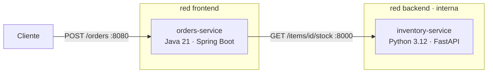

# Arquitectura

## Visión general

Dos microservicios de lenguajes distintos, orquestados con Docker Compose. `orders-service` valida el stock consultando a `inventory-service`.

## Servicios

| Servicio | Stack | Puerto | Endpoints | Pruebas |
|---|---|---|---|---|
| `inventory-service` | Python 3.12, FastAPI | 8000 (solo red interna) | `GET /health`, `GET /items`, `GET /items/{id}/stock` | PyTest + pytest-cov, ruff |
| `orders-service` | Java 21, Spring Boot 3.5 | 8080 (publicado en 127.0.0.1) | `GET /actuator/health`, `POST /orders` | JUnit 5 + JaCoCo |

Respuestas de `POST /orders`: `201` creado, `400` datos inválidos, `404` ítem inexistente, `409` stock insuficiente, `503` inventario no disponible.

## Contenedores (IE1)

| Decisión | Motivo |
|---|---|
| Multi-stage build | El runtime no incluye compiladores, Maven ni pip |
| `python:3.12-slim` (y no Alpine) | Alpine usa musl y complica las wheels precompiladas; slim es más compatible y sigue siendo liviana |
| `eclipse-temurin:21-jre-alpine` | Solo JRE, sin JDK |
| Capas de Spring Boot (`layertools`) | Un cambio de código no invalida la capa de dependencias |
| Usuario no-root (UID 10001) | Reduce el impacto de una vulnerabilidad |
| `HEALTHCHECK` propio | Compose lo usa para ordenar el arranque |
| `.dockerignore` | Deja fuera tests, `.git`, `.env` y artefactos |

## Orquestación (IE5)

| Característica | Implementación |
|---|---|
| Orden de arranque | `depends_on` con `condition: service_healthy` y `restart: true` |
| Aislamiento | Red `backend` con `internal: true`; solo `orders-service` en `frontend` |
| Escalabilidad | Sin `container_name` ni puertos fijos en inventory: `docker compose up --scale inventory-service=3` |
| Estabilidad | `restart: unless-stopped`, límites de CPU y memoria, rotación de logs |
| Configuración | Variables por `.env` (`IMAGE_PREFIX`, `IMAGE_TAG`, `GIT_SHA`, `ORDERS_PORT`) |
| Endurecimiento | FS de solo lectura, `cap_drop: ALL`, `no-new-privileges` |

## Decisiones técnicas

| Decisión | Alternativa descartada | Motivo |
|---|---|---|
| Monorepo | Un repositorio por servicio | Un solo pipeline y una sola historia de commits: trazabilidad más simple |
| GHCR | Docker Hub | Usa el `GITHUB_TOKEN`, sin cuentas ni secretos adicionales |
| SonarCloud | SonarQube propio | Gratuito para repos públicos y sin infraestructura |
| Trivy | Solo Dependabot | Detecta vulnerabilidades transitivas dentro del JAR y de la imagen |
| Compose en el runner | Nube real | Es el "entorno cloud simulado" que pide la evaluación |
| Sin base de datos | PostgreSQL | Evita acoplar la persistencia al alcance de la evaluación |

## Mejoras futuras

- Migrar a Spring Boot 4.x y retirar las excepciones de Trivy.
- Persistencia con PostgreSQL (volumen y secretos).
- Firmar las imágenes (cosign) y generar SBOM.
