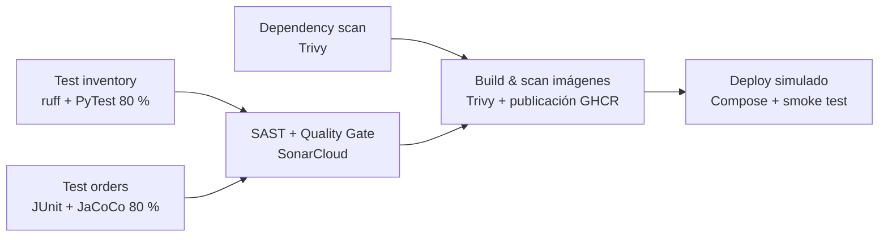

# Pipeline CI/CD

Definido en `.github/workflows/ci-cd.yml` (GitHub Actions).

## Disparadores

| Evento | Qué ejecuta |
|---|---|
| Pull request hacia `main` o `develop` | Pruebas, escaneos y build. **No** publica ni despliega |
| Push a `main` o `develop` | Todo lo anterior, publicación en GHCR y despliegue simulado |
| Tag `vX.Y.Z` | Publicación con tags semánticos y despliegue simulado |
| Manual (`workflow_dispatch`) | Igual que un push |

## Etapas



| Job | Qué hace | Falla si... |
|---|---|---|
| Test inventory-service | `ruff check` y `pytest` con cobertura | Hay errores de lint, un test falla o la cobertura es menor al 80 % |
| Test orders-service | `mvn verify` (JUnit + JaCoCo) | Un test falla o la cobertura de líneas es menor al 80 % |
| Dependency scan (Trivy) | Escanea `requirements.txt` y `pom.xml` | Hay vulnerabilidades CRITICAL no exceptuadas |
| SAST + Quality Gate | Análisis SonarCloud con cobertura de ambos servicios | El Quality Gate no pasa |
| Build & scan (matriz) | Construye cada imagen, la escanea y la publica | La imagen tiene vulnerabilidades CRITICAL no exceptuadas |
| Deploy simulado | `docker compose pull`, `up --wait`, smoke test | Falla un healthcheck, el smoke test o la verificación de trazabilidad |

## Políticas de calidad

| Política | Valor |
|---|---|
| Cobertura mínima | 80 % por servicio (PyTest `--cov-fail-under`, JaCoCo `check`) |
| Lint Python | ruff sin errores |
| Vulnerabilidades | Sin CRITICAL en dependencias ni imágenes (salvo excepciones de `.trivyignore.yaml`) |
| Quality Gate | Verde en SonarCloud |
| Merge | Bloqueado en `main` y `develop` si falla alguno de los 6 checks |

## Trazabilidad (IE4)

Cada versión desplegada se puede rastrear hasta su commit, sus pruebas y su construcción.


| Etapa | Identificador | Dónde verlo |
|---|---|---|
| Commit | SHA de 40 caracteres | Historial de Git y Actions |
| Pruebas | Run de Actions, artefactos `coverage-inventory-service` y `orders-build` | Pestaña Actions → run → Artifacts |
| Análisis | Proyecto `msalgadof_devops-ep2-pipeline` | SonarCloud |
| Build | Imagen `ghcr.io/msalgadof/<servicio>:sha-<7 caracteres>` | Packages del repositorio |
| Metadatos de imagen | Label `org.opencontainers.image.revision` = SHA completo | `docker image inspect` |
| Deploy | Tabla de resumen del job *Deploy simulado* | Actions → run → Summary |

El job de despliegue **verifica** que el label `revision` de cada imagen desplegada coincida con el commit del run. Si no coincide, falla.

Tags de imagen: `sha-<7>` (siempre), nombre de rama, `latest` (rama por defecto) y `X.Y.Z` y `X.Y` al publicar un tag `vX.Y.Z`.

## Ejecutar localmente

```bash
./scripts/verify.sh            # tests, cobertura, imágenes, no-root y end-to-end
./scripts/verify-compose.sh    # orquestación, aislamiento, escalado y resiliencia
docker compose up -d --build --wait && ./scripts/smoke-test.sh
```

## Secretos y permisos

| Secreto | Uso |
|---|---|
| `SONAR_TOKEN` | Análisis en SonarCloud |
| `GITHUB_TOKEN` | Automático. Publicar y leer imágenes en GHCR |

Cada job declara solo los permisos que necesita (`contents: read`; `packages: write` únicamente al publicar).

## Problemas frecuentes

| Síntoma | Causa y solución |
|---|---|
| Sonar falla con "Automatic Analysis" | Desactivar el análisis automático en SonarCloud |
| Trivy bloquea con un CRITICAL | Actualizar la dependencia; si no hay parche, documentar la excepción en `.trivyignore.yaml` |
| Deploy falla en `docker compose pull` | Revisar que las imágenes `sha-<7>` existan en GHCR |
